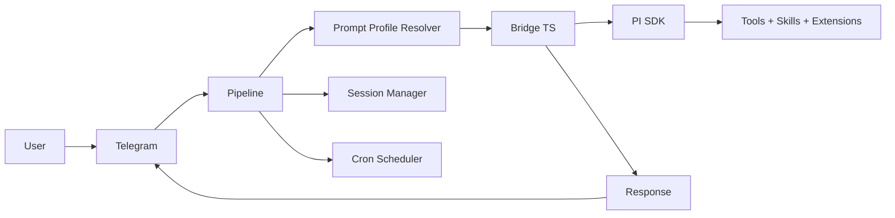

<div align="center">

# Aurelia OS


**A local-first personality and context layer for SDK-powered AI execution.**

Telegram-native, terminal-friendly, PI-powered. Built to stay light.

One persistent daemon, many projects, many prompt profiles.

[](https://go.dev/)
[](#runtime-model)
[](.specs/codebase/ARCHITECTURE.md)
[](https://sqlite.org/)
[](https://core.telegram.org/bots/api)
[](https://pi.dev)

</div>

## Prerequisites

Before installing, ensure you have:

- **Go** `1.27` — [go.dev](https://go.dev/)
- **Node.js** `>=22.19.0` and **npm** `9+` — [nodejs.org](https://nodejs.org/)
  - *The PI SDK (inference engine) installs automatically via npm on first run*
  - *No need to install the PI CLI (`pi`) or run `pi /login`*
- **git** `2+`
- **gh** (GitHub CLI) — optional but recommended
- A **Telegram bot token** from [@BotFather](https://t.me/botfather)
- An **LLM provider API key**:
  - **OpenRouter** — recommended (multi-model proxy, one key for many models)
  - **opencode-go** — alternative (OpenCode API key)

## Why Aurelia OS

Aurelia is a local-first personality layer over AI execution SDKs. Talk naturally from Telegram or the terminal TUI — Aurelia adds identity, memory, project context, guard-rails, and a selected prompt profile, then delegates reasoning and tool execution to the SDK harness.

It is built around a practical execution model:

- Go daemon (24/7, lightweight, cross-platform)
- TypeScript Bridge wrapping the PI SDK
- PI SDK as the current execution harness (reasoning, tools, skills, extensions, sessions)
- Canonical Go module and repository under `github.com/igormaneschy/aurelia`
- PI-backed session management with `session_file` resume and SDK compaction
- Persistent memory via ai-memory with a bounded project working set
- Prompt profiles in markdown for context/personality injection, with legacy agent-file compatibility
- Multi-provider: OpenRouter (recommended), opencode-go, Anthropic, Kimi, Z.ai, Alibaba
- API key authentication (OpenRouter, opencode-go)
- Bridge recovery with automatic retry on crash

The goal is not to reimplement what PI or future SDKs already do.
The goal is to wrap them with personality and product context — adding persistence, memory, scheduling, multi-project support, guard-rails, and natural Telegram/TUI interfaces on top.

### Architectural Thesis

Aurelia is the **product layer** on top of the PI SDK engine:

```text
Telegram / TUI / CLI / Cron / future interfaces
        ↓
Aurelia Product Layer
identity · persona · prompt profiles · Telegram/TUI UX · workflows · ai-memory working set · policies · project binding
        ↓
PI SDK
reasoning · tool execution · sessions · agent runtime · model/provider abstraction
        ↓
Tools / filesystem / web / APIs / projects
```

The boundary is intentional:

- **PI SDK owns** model/provider resolution, tool execution, session runtime, compaction, context-file loading, skills/extensions, MCP tools, and agentic execution primitives.
- **PI + ai-memory MCP owns** transversal Wiki memory used by PI, PI Code/opencode, and other MCP-compatible clients.
- **Aurelia owns** identity, personality, Prompt Profile selection/injection, Telegram/TUI UX, project binding, cron, audit, and the bounded ai-memory working set.
- When the PI SDK already owns a capability, Aurelia adapts to it rather than reimplementing it.
- When the capability is product-specific policy, UX, or workflow state, Aurelia remains the source of truth; durable memory and handoffs belong to ai-memory.

The long-term differentiator is the persistent local product layer over PI: Telegram for async/mobile work, the TUI for focused terminal work, and shared daemon state where it is safe. Transversal Wiki memory is delegated to PI through the existing `ai-memory` MCP rather than reimplemented as an Aurelia gateway.

### No Planning Mode / No Orchestrator

Aurelia does **not** implement a separate planning mode, `aurelia-plan` blocks, `/execute`, or worker orchestration. Agentic execution — reasoning, tool use, multi-step work, and human-in-the-loop approvals — is owned entirely by the **PI SDK**. Aurelia's pipeline sends each user message to the bridge and delivers the SDK response back to Telegram/TUI. Do not reintroduce plan detection, pending plans, or an `internal/orchestrator/` package.

## Core Capabilities

- **Natural conversation** via Telegram with text, photos, voice, and documents
- **Local terminal UI** via `aurelia-tui` with streaming markdown, isolated local sessions, sidebar navigation, and project state overlay
- **Autonomous coding** — reads, writes, edits files, runs commands, searches code
- **Multi-project** — work on different projects simultaneously with isolated contexts
- **Persistent memory** — ai-memory is the durable memory/handoff source; Aurelia injects a bounded project working set and exposes the memory tools
- **Prompt profiles** — `/mode` selects the default profile; `@profile` applies a one-shot profile; `/agents` lists available profiles
- **Multi-provider** — OpenRouter (recommended), opencode-go, Anthropic, Kimi, Z.ai, Alibaba
- **Session continuity** — PI session resume plus ai-memory handoffs and session observations; Aurelia never owns a second editable memory store
- **Profile routing** — explicit `@profile` or default `/mode` controls how Aurelia packages the request before SDK execution
- **Persistent scheduling** — create cron jobs via natural conversation, results delivered to Telegram
- **Bridge recovery** — automatic retry with session resume when the Bridge process crashes
- **Tool progress** — see what PI is doing in real-time (reading files, running commands...)
- **Reply-to** — responses quote the original message for async conversation clarity
- **Photo analysis** — images downloaded and passed to PI for visual analysis
- **TUI image input** — `/img`, clipboard paste, and drag-and-drop route screenshots/images to vision-capable models
- **TUI document attachments** — `/attach` and drag-and-drop copy files safely into `<cwd>/uploads/` for the agent to inspect
- **Telegram document attachments** — with an active project (`/cwd`), Word,
  Excel, PowerPoint, PDF, Markdown, and other documents are saved unchanged in
  `<cwd>/uploads/`. The agent receives the exact absolute path, original name,
  size, and caption, then chooses how to read the file with its tools. Aurelia
  does not extract content or convert formats. Uploads remain available for
  later turns; delete them manually when no longer needed. The limit is 25 MB
  per file (Telegram's Bot API may impose a smaller download limit).
- **Voice transcription** — Groq STT converts voice messages to text (Whisper)
- **Vision fallback** — configure a separate vision model for image inputs
  while keeping a faster text-only model as default
- **Operational observability** — structured slog logging (text/JSON), durable run
  timelines with `run_events`, extended `run_journal` (provider, model, tokens,
  cost, errors, timeout, fallback), metrics queries, and debug commands
## Runtime Features

Aurelia uses a TypeScript Bridge adapting the PI SDK as its inference and execution engine:

- **Bridge** — `bridge/index.ts` wraps `@earendil-works/pi-coding-agent` and is embedded into the Go binary.
- **API key auth** — provider keys are configured during onboarding and exported to the bridge runtime environment.
- **Streaming progress** — PI tool events are mapped back into Telegram progress messages.
- **Long-lived sessions** — Bridge requests preserve PI `session_file` paths; context pruning is handled by PI SDK compaction. Aurelia does not auto-rotate sessions due to token count.
- **Observability** — every run gets a unique `run_id` with timeline events
  (`bridge_request_started`, `tool_use`, `run_completed`, etc.); phase events
  are persisted in `run_events` table and queryable via CLI or Telegram debug
  commands.

## Runtime Model

Aurelia separates three scopes:

1. **Repository** — product source code
2. **Local instance** — user runtime state (`~/.aurelia/`)
3. **Target projects** — external codebases the agent works on

High-level flow:



### Message Flow

```
1. Message arrives on Telegram
2. Pipeline extracts text/photo/voice/document
3. Prompt profile resolver selects `@profile`, active `/mode`, or `general`
4. System prompt assembled: persona + profile + ai-memory working set/handoff + Telegram context
5. Request sent to Bridge (long-lived TypeScript process)
6. Bridge calls PI SDK → SDK harness executes
7. Events streamed back: tool_use → progress, assistant → text, result → response
8. Response delivered to Telegram (reply-to original message)
9. PI SDK manages context compaction; Aurelia stores the returned `session_file` for resume
```

### Cron Flow

```
1. Scheduler polls every 15 seconds
2. Due job found → load prompt profile/context + persona
3. Execute via Bridge/SDK harness (Telegram plugin blocked to prevent wrong bot)
4. Result delivered to Telegram via TelegramDelivery
```

## Architecture

```text
cmd/aurelia/              CLI entry point, onboarding, cron CLI, telegram CLI
cmd/aurelia-tui/          Local terminal UI binary
internal/bridge/          Go <> Bridge client (long-lived, multiplexed, bundle embedded via go:embed)
internal/telegram/        Telegram I/O, async pipeline, progress, reactions, commands
internal/tui/             Bubble Tea model/update/view, local sessions, attachments, images
internal/tuisessions/     SQLite store for TUI-local named sessions
internal/session/         Session file store, conversation CWD state, nudge buffer
internal/agents/          Legacy prompt-profile registry (`~/.aurelia/agents/*.md`, `@profile` compatibility)
internal/persona/         Persona loader (IDENTITY / SOUL / USER)
internal/dream/           Memory consolidation (dream) and extraction (nudge)
internal/cron/            Persistent cron scheduler with Telegram delivery
internal/config/          App configuration (providers, Telegram, sessions)
internal/runtime/         Path resolver + instance bootstrap + project memory dirs
internal/pipeline/        Turn driver: prompt assembly, bridge call, run supervisor
pkg/stt/                  Speech-to-text (Groq Whisper)
bridge/                   TypeScript Bridge source (compiled to bundle.js via esbuild, embedded in binary)
```

### Bridge Protocol

The Bridge is a **long-lived** TypeScript process that wraps `@earendil-works/pi-coding-agent`. Communication is via stdin/stdout NDJSON with request multiplexing:

**Go → Bridge (stdin):**
```json
{"command":"query","request_id":"req-1","prompt":"...","options":{"model":"k2.5","system_prompt":"...","cwd":"/path","permission_mode":"bypassPermissions"}}
```

With image attachments:
```json
{"command":"query","prompt":"Analise esta imagem","options":{"images":[{"data":"<base64>","media_type":"image/jpeg"}]}}
```

**Bridge → Go (stdout):**
```json
{"event":"system","request_id":"req-1","session_id":"abc-123","session_file":"/path/to/session.jsonl","tools":["Read","Write"]}
{"event":"tool_use","request_id":"req-1","name":"Read","input":{"file_path":"src/main.go"}}
{"event":"assistant","request_id":"req-1","text":"The project has..."}
{"event":"result","request_id":"req-1","content":"...","cost_usd":0.12,"session_id":"abc-123","session_file":"/path/to/session.jsonl"}
```

Multiple requests run concurrently — each with its own `request_id`.

### Prompt Profiles (`/mode`, `/agents`, `@profile`)

Aurelia does not run independent worker agents. It selects a **Prompt Profile** — a markdown-defined set of complementary instructions and optional execution hints — and injects it into the request sent to the SDK harness.

```text
/mode developer          # make developer the default profile
@researcher compare SDKs # use researcher once, without changing the default
/agents                  # list available profiles
/agents verbose          # owner DM: model/capability hints
```

Resolution order for each message:

```text
explicit @profile > active /mode profile > general
```

**Storage** (highest precedence first):

| Path | Scope |
|------|-------|
| `~/.aurelia/users/<id>/profiles/*.md` | User-private |
| `~/.aurelia/profiles/*.md` | Global canonical |
| `~/.aurelia/agents/*.md` | Legacy (compat) |
| Builtins | `general`, `developer`, `researcher` |

Legacy `personas/mode_developer.md` overlays merge into the matching builtin
when no user-private `profiles/developer.md` exists.

Full guide: [`docs/prompt-profiles.md`](docs/prompt-profiles.md)

### Persona

Three markdown files in `~/.aurelia/memory/personas/`:

- `IDENTITY.md` — name, role, rules, personality
- `SOUL.md` — tone, style, behavior
- `USER.md` — user information, preferences

Created automatically via `/start` on Telegram (choose "Coder" or "Assistant" preset).

## Memory System

The personal ai-memory instance is the single durable memory and handoff source.
Aurelia is a thin context adapter over it:

- **Project/global/profile scopes** live in ai-memory, selected by the project
  `.ai-memory.toml` marker and explicit `workspace`/`project` arguments.
- **Session observations and handoffs** replace the old continuity store; the
  Pi extension records them and injects the pending handoff at session start.
- **Bounded working set** — before each turn Aurelia reads
  `memory_briefing`/`memory_read_page` and injects only counts, rules, recent
  page excerpts and the pending-handoff count. It is read-only and cached.
- **Tools** — `memory_query`, `memory_read_page`, `memory_briefing`,
  `memory_explore`, `memory_read_session_observations`, handoff and explicit
  write/maintenance tools are available to the model.
- **Degraded mode** — if ai-memory is unavailable, Aurelia uses the last cached
  working set and reports the outage; it never falls back to another instance.

`/memory` shows the project page/observation/session/handoff state. There is no
local `MEMORY.md`, `cwd_overlay`, topic/user-global file layer, Dream/Nudge
consolidation or `/memory checkpoint`; `/reset` clears the PI session and
cancels pending handoffs.

## Telegram Commands

| Command | Description |
|---------|-------------|
| `/start` | Setup persona (first run) or welcome |
| `/help` | List available commands |
| `/new` | New session (clears context, cancels pending handoffs) |
| `/cwd <path>` | Set working directory for this chat |
| `/reset` | Reset session (alias for `/new`) |
| `/usage` | Show session token usage and cost |
| `/status` | Show daemon status, model, session, and latest run info |
| `/cron` | Manage schedules (list, add, delete, pause, resume) |
| `/agents` | List available prompt profiles (`@profile` shortcuts) |
| `/mode` | Show or set the default prompt profile |
| `@profile <text>` | Use a prompt profile once for the current message |
| `/model` | Show or change the SDK model selection; refreshes from the current PI model catalog |
| `/memory` | Show the ai-memory project/page/observation/handoff status |
| `/debug last` | Show latest run summary (status, provider, cost, duration) — owner only |
| `/debug run <id>` | Show full metadata and timeline for a specific run — owner only |
| `/debug errors` | Show recent failed/timed-out runs — owner only |

## Terminal TUI

`aurelia-tui` is a local terminal client for the running Aurelia daemon. It
talks to the daemon over the Unix socket at `~/.aurelia/aurelia.sock`, so the
daemon must be installed/running first (`make deploy` or the launchd service).

> **Current personal deployment (2026-11-07):** the TUI client is disabled;
> desktop (Mac, NAS mode) + Telegram are the used surfaces. The desktop still
> uses the TUI session namespace (`tui_sessions.db`, `-9000001…`), so do not
> delete that database.

```bash
# Build and run the local TUI from the repository
go build -o ./aurelia-tui ./cmd/aurelia-tui
./aurelia-tui
```

The TUI supports streaming replies, markdown rendering, isolated named sessions,
safe project bindings, image input, document attachments, queued messages,
clipboard transcript copy, mouse/keyboard scroll, periodic daemon health checks,
theme selection, help/project overlays, and a compact status/sidebar layout.

| Command / shortcut | Description |
|--------------------|-------------|
| `/help` | Show TUI commands and keyboard shortcuts |
| `/status` | Show daemon, model, cwd, and session status |
| `/cwd` | Show the current TUI project binding |
| `/cwd <path>` | Set the TUI working directory/project binding |
| `/cwd clear` | Remove the TUI project binding |
| `/model` | List models from the current PI model catalog |
| `/model <name>` | Switch model after validating against the PI catalog |
| `/model auto` | Let PI choose the model automatically |
| `/model refresh` | Refresh the PI model catalog and report model count |
| `/img <path>` | Attach an image for vision analysis |
| `/attach <path>` | Copy a document into `<cwd>/uploads/` and reference it in the prompt |
| `Ctrl+S` / `F2` | Focus the session sidebar |
| Sidebar `↑↓`, `Enter`, `n`, `r`, `d` | Navigate, open, create, rename, or delete TUI sessions |
| `Esc` | Cancel the current streaming response |
| `Ctrl+L` | Clear the visible chat history |
| `Ctrl+O` | Toggle mouse capture for scroll vs native terminal text selection |
| `Ctrl+P` | Toggle the project state overlay |
| `?` | Toggle the help overlay |
| `Ctrl+V` | Paste image from clipboard when supported |
| `Ctrl+X` | Clear pending image/document attachments |
| `Ctrl+Y` / `Ctrl+R` | Copy chat transcript / last Aurelia response to clipboard |
| `Alt+Enter` / `Ctrl+J` | Insert a newline in the input |
| `Tab` | Cycle command suggestions while typing `/...` |
| `PgUp` / `PgDown` / mouse wheel | Scroll chat history |

## CLI

```bash
# Run the daemon
go run ./cmd/aurelia/

# Run the local TUI after the daemon is running
go run ./cmd/aurelia-tui/

# Interactive onboarding
go run ./cmd/aurelia/ onboard

# Cron management
aurelia cron add "30 8 * * *" "pesquise noticias de tech" --chat-id 123456 --cwd /path/to/project
aurelia cron once "2026-03-22T09:00:00Z" "gere relatorio" --chat-id 123456 --cwd /path/to/project
aurelia cron list
aurelia cron del <job-id>

# Telegram interaction (used by the agent via Bash)
aurelia telegram react <chat-id> <message-id> <emoji>
aurelia telegram send <chat-id> <text>
aurelia telegram reply <chat-id> <message-id> <text>

# Operational debug (view runs, errors, metrics)
aurelia debug last                    # Latest run with timeline
aurelia debug run <run_id>            # Full metadata + timeline
aurelia debug errors --limit 20       # Recent failed/timed-out runs
aurelia debug metrics --days 1        # Aggregate metrics (p50/p95, cost, breakdowns)
aurelia debug last --json             # Machine-readable JSON output
```

## Setup

Requirements:

- Go `1.27`
- Node.js `>=22.19.0` and npm `9+` (the PI SDK installs automatically on first run)
- Telegram bot token
- One LLM provider:
  - **OpenRouter** — recommended (multi-model proxy, one key for many models)
  - **opencode-go** — alternative (OpenCode API key)
  - **Local models** — Ollama or any OpenAI-compatible local server (optional, see [Local Models](#local-models))
- Groq API key for voice transcription (optional)

### Quick Start

1. **Clone** the repository:
   ```bash
   git clone https://github.com/igormaneschy/aurelia.git
   cd aurelia
   ```

   > **Note**: You do not need to install the PI CLI (`pi`) or run `pi /login`. The PI SDK is bundled and installed automatically by Aurelia.

2. **Run the onboarding wizard** (required before first start):
   ```bash
   go run ./cmd/aurelia/ onboard
   ```
   This interactive wizard will guide you through:
   - Dependency verification
   - LLM provider selection (OpenRouter or opencode-go)
   - API key configuration
   - Telegram bot token validation
   - User access control

3. **Start the daemon**:
   ```bash
   go run ./cmd/aurelia/
   ```

4. **Send `/start`** to your bot on Telegram.

> **Note**: If you skip step 2 and run the daemon directly, it will exit with instructions to complete onboarding first.

### Hot Reload (Development)

```bash
go install github.com/air-verse/air@latest
air
```

### Config

Main config lives in `~/.aurelia/config/app.json`:

```json
{
  "default_provider": "openrouter",
  "default_model": "auto",
  "providers": {
    "openrouter": { "api_key": "sk-or-..." },
    "opencode": { "api_key": "sk-..." },
    "groq": { "api_key": "gsk-..." }
  },
  "telegram_bot_token": "your-token",
  "telegram_allowed_user_ids": [123456789],
  "stt_provider": "groq",
  "vision_model": "auto",
  "vision_provider": "openrouter",
  "max_iterations": 500,
  "max_session_tokens": 100000
}
```

Provider auth uses API keys configured during onboarding. OpenRouter is recommended as it provides access to multiple models with a single key.

### Release Build

```bash
go build -trimpath -ldflags "-s -w" -o ./build/aurelia ./cmd/aurelia
go build -trimpath -ldflags "-s -w" -o ./build/aurelia-tui ./cmd/aurelia-tui
```

## Local Models

Aurelia supports local models via [Ollama](https://ollama.com/) or any OpenAI-compatible inference server. This is ideal for offline work, privacy, or cost reduction.

### Setup

1. **Install Ollama** and pull a model:
   ```bash
   ollama pull llama3.1:8b
   ollama pull qwen2.5-coder:7b
   ```

2. **Configure PI models** by editing `~/.pi/agent/models.json`:

   Aurelia keeps `~/.aurelia/pi-agent/models.json` as a symlink to this PI CLI
   file, so Telegram `/model`, TUI `/model`, and `pi --list-models` read the
   same catalog.
   ```json
   {
     "providers": {
       "ollama": {
         "baseUrl": "http://localhost:11434/v1",
         "api": "openai-completions",
         "apiKey": "ollama",
         "compat": {
           "supportsDeveloperRole": false,
           "supportsReasoningEffort": false,
           "supportsToolChoice": false
         },
         "models": [
           {
             "id": "llama3.1:8b",
             "name": "Llama 3.1 8B (local)",
             "reasoning": false,
             "input": ["text"],
             "contextWindow": 128000,
             "maxTokens": 32000,
             "cost": { "input": 0, "output": 0, "cacheRead": 0, "cacheWrite": 0 }
           },
           {
             "id": "qwen2.5-coder:7b",
             "name": "Qwen2.5 Coder 7B (local)",
             "reasoning": false,
             "input": ["text"],
             "contextWindow": 32768,
             "maxTokens": 8192,
             "cost": { "input": 0, "output": 0, "cacheRead": 0, "cacheWrite": 0 }
           }
         ]
       }
     }
   }
   ```

3. **Update Aurelia config** (`~/.aurelia/config/app.json`):
   ```json
   {
     "default_provider": "ollama",
     "default_model": "llama3.1:8b"
   }
   ```

4. **Restart the daemon**:
   ```bash
   make restart
   ```

### Notes

- Ollama must be running (`ollama serve`) before starting Aurelia
- The `apiKey` field is required by the PI SDK but ignored by Ollama — any value works
- Local models do not support image input or advanced tool calling — use cloud providers for those features
- For other local servers (vLLM, LM Studio, etc.), adjust `baseUrl` and `api` accordingly

## Documentation

| Document | Purpose |
|----------|---------|
| [CLAUDE.md](CLAUDE.md) | Instructions for coding agents |
| [CHANGELOG.md](CHANGELOG.md) | Release history and changes |
| [docs/NAS_OPERATIONS.md](docs/NAS_OPERATIONS.md) | NAS personal assistant runbook (systemd, ai-jail, ai-memory, Telegram, desktop tunnel) |
| [openspec/changes/memory-consolidation/](openspec/changes/memory-consolidation/) | ai-memory-native memory/context consolidation proposal |
| [desktop/README.md](desktop/README.md) | Desktop client (local and NAS/Tailscale modes) |
| [docs/OPERATIONS.md](docs/OPERATIONS.md) | macOS local/fallback operations and current NAS pointers |
| [docs/OBSERVABILITY.md](docs/OBSERVABILITY.md) | Operational observability guide (debug, metrics, log config) |
| [.specs/codebase/ARCHITECTURE.md](.specs/codebase/ARCHITECTURE.md) | System architecture and patterns |
| [.specs/codebase/CONVENTIONS.md](.specs/codebase/CONVENTIONS.md) | Code conventions and Go patterns |
| [.specs/codebase/STACK.md](.specs/codebase/STACK.md) | Technology stack and dependencies |
| [.specs/project/PROJECT.md](.specs/project/PROJECT.md) | Vision, constraints, current state |
| [.specs/project/ROADMAP.md](.specs/project/ROADMAP.md) | Feature roadmap and implementation order |

## Development

```bash
go build ./...        # Build
go test ./... -short  # Test
go vet ./...          # Lint
air                   # Hot reload
```

To rebuild the Bridge bundle after modifying `bridge/index.ts`:

```bash
make bridge           # bundles + copies into internal/bridge/
```

To build/install both daemon and TUI for local service validation:

```bash
make deploy           # atomic daemon + TUI build, then service restart/kick
```

## Running as a Service

### macOS (launchd)

```bash
make install-service  # one-time: install launchd plist (auto-restart, RunAtLoad)
make deploy           # build atomically + kick the daemon
make logs             # tail daemon stderr
make status           # show launchd state
```

### Linux (systemd)

```bash
make install-service-linux  # one-time: install user systemd service
make deploy                 # build atomically + restart service
journalctl --user -u aurelia -f  # tail logs
```

Full guide: [docs/OPERATIONS.md](docs/OPERATIONS.md). For the personal NAS
deployment (systemd user units, ai-jail, ai-memory, desktop/Tailscale tunnel),
use [docs/NAS_OPERATIONS.md](docs/NAS_OPERATIONS.md).

## Troubleshooting

| Problem | Solution |
|---------|----------|
| Daemon exits immediately | Run `go run ./cmd/aurelia/ onboard` first |
| "Token is invalid" during onboard | Verify token with @BotFather, ensure bot is not already running elsewhere |
| Bridge fails to build | Check `node --version` ≥ 22.19 and `npm --version` ≥ 9 |
| "Dependency missing" error | Install the missing tool and re-run onboarding |
| TUI cannot connect | Start/install the daemon first, then run `aurelia-tui`; local IPC uses `~/.aurelia/aurelia.sock` |
| TUI timestamps look wrong after reload | Update to `v0.30.1+`; restored history preserves PI message timestamps |

## Current State

- **v0.54.0** on `main` (released 2026-11-08) — see [CHANGELOG.md](CHANGELOG.md)
- Next release: TBD
- Canonical repository: `https://github.com/igormaneschy/aurelia`
- Go module: `github.com/igormaneschy/aurelia`
- Go test suite is green
- TypeScript Bridge compiles clean
- Runtime target: macOS/Linux local daemon and a personal native NAS deployment;
  Windows support is not a current operational target
- Current personal mode: NAS daemon (systemd user service) + Mac desktop over a
  Tailscale SSH streamlocal tunnel + Telegram; the TUI client is disabled. See
  [docs/NAS_OPERATIONS.md](docs/NAS_OPERATIONS.md) and
  [desktop/README.md](desktop/README.md).
